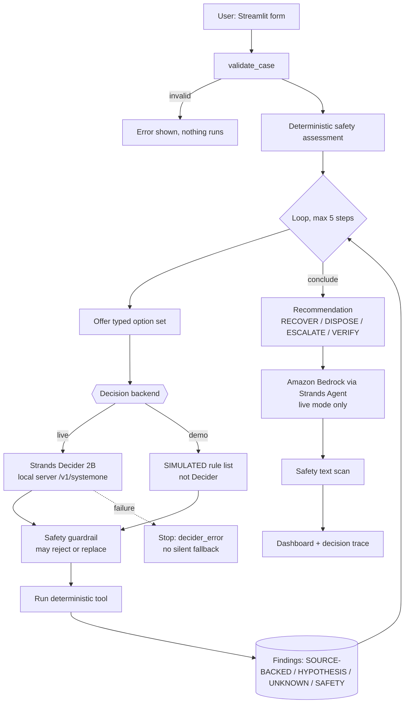

# Architecture

| Module | Role |
|---|---|
| `agent/decider.py` | Typed option set, state text, live HTTP client, simulated backend |
| `agent/safety.py` | Validation, assessment, guardrail rules S0–S5, unsafe-text scanner |
| `agent/workflow.py` | The loop, tool registry, recommendation, "why not" explanation |
| `agent/generation.py` | Bedrock via Strands `Agent` + `BedrockModel`, error mapping, fallback |
| `tools/*` | Deterministic investigation tools over `data/*.json` |

Guardrail rules: S0 no repeats · S1 emergency → escalate first · S2 no recovery for unknown/high-risk · S3 escalate before disposal for unknown ·
S4 cannot conclude high-risk without escalation, or before any evidence · S5 no info request when nothing is missing.

Honesty rules: live and simulated decisions carry `live=True/False`; confidence/probabilities are stored only if the server returned them; a Decider failure stops the run.
